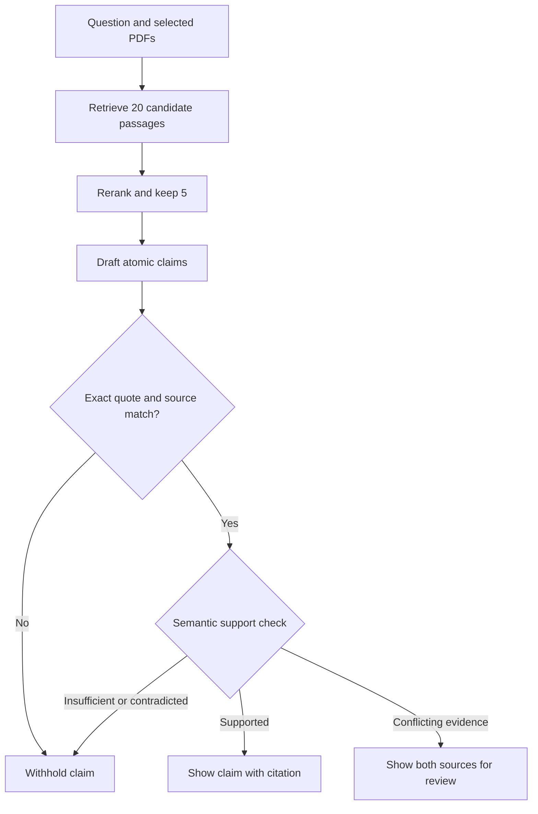

# VeritasAI — Self-Verifying AI Research Assistant

**[Open the live website →](https://veritas-ai-v8lw.vercel.app/)**

[How to use it](docs/USER_GUIDE.md) · [Where your data goes](docs/PRIVACY.md) · [What each file does](docs/FILE_GUIDE.md) · [Test results](docs/VALIDATION.md) · [Project report](docs/PROJECT_REPORT.md)

### Ask your PDFs. Check the evidence.

VeritasAI is a research workspace that helps you ask questions about PDFs and check whether individual claims are supported by those documents.

A useful answer should let you ask, **“Where did that come from?”** In VeritasAI, each citation opens the exact PDF page and supporting text. If a claim is unsupported, the app withholds it. If retrieved sources appear to disagree, you can inspect both sides.

**Account and privacy upgrade:** this version adds email/password accounts, encrypted content storage, and an explicit review before any Gemini request. Source excerpts and claim checks need no AI key. See [release validation](docs/VALIDATION.md) for the exact tested commit and deployment status; older live-test reports describe the previous anonymous-workspace version.

## Problem statement

AI can produce an answer that sounds convincing even when a document does not support it. A citation can be real while the claim attached to it is wrong. Different reports can also disagree, leaving the reader to check every page manually.

**The goal:** help readers inspect the evidence behind each factual claim, identify uncertainty, and measure whether extra verification improves answers. The application cannot guarantee that an answer or its source is true.

## Our solution

VeritasAI connects document search, optional answer generation and a separate evidence checker:

1. **Read:** upload PDFs and keep the original pages alongside extracted text.
2. **Find:** retrieve relevant passages and rerank them for the question.
3. **Draft:** when a generator is connected, request short, individually cited claims.
4. **Check:** confirm that the quoted words exist and estimate whether they support each claim.
5. **Show:** present accepted claims with exact sources; withhold unsupported claims and surface possible disagreements.
6. **Measure:** compare ordinary RAG, reranked RAG and verified RAG using independently reviewed answers.

RAG means *retrieval-augmented generation*: the model receives passages found in your documents before writing its answer. The research question is whether claim-level checking reduces unsupported answers **without hiding too many useful facts**. That improvement has not yet been established on a large independent benchmark.

## Privacy you can see and control

Create an account with **email, password and confirm password**. Save the recovery code shown once. Each account has its own document workspace, and the server checks ownership on every private request.

| Protection | What it actually does |
|---|---|
| External AI starts off | The server blocks Gemini until you enable reviewed requests in **Privacy center**. A supplied API key cannot bypass this. |
| Review before sharing | See the exact outgoing question and passages. Original source labels are replaced. Obvious emails, phone numbers and secrets are masked. Approve one request or cancel. |
| Encrypted content storage | AES-256-GCM protects PDF bytes, filenames, page/chunk text, saved questions/answers and account email fields before database storage. |
| History starts off | New answers are not saved unless you enable history. You can also make one answer temporary. Uploaded PDFs still remain until deleted. |
| Private sessions | HttpOnly cookies, server-side expiry, 30-minute inactivity lock, and sign-out on all devices. Passwords use Argon2id hashes. |
| Data controls | Export your text and answers, clear history, delete workspace data, or delete your account after confirming your password. |
| Visible privacy receipts | Every answer says whether an external AI was used and whether history was saved. A content-free activity log records privacy actions. |

**This is not end-to-end encryption or a 100% leak-proof service.** The server can decrypt content to process it. Search vectors, document hashes, sizes, page numbers and timestamps remain readable database metadata. Automatic masking can miss names and other private information. Backups and Google have their own retention rules.

[Read the plain-English privacy guide](docs/PRIVACY.md) and [technical security notes](docs/SECURITY.md). Start with fictional samples or public papers.

## Try it in two minutes — no installation

1. Open your configured account-release deployment (see the release note above). Create an account, confirm your password, and save your recovery code. Then wait for **Workspace ready**.
2. Click **Try our authored sample documents**, or upload a text-based PDF.
3. Choose **Check a claim**. Enter: `The Cedar trial enrolled 120 adults.`
4. Press the arrow button. Open a source under the answer to see its page and highlighted text.
5. Try: `The Cedar trial was funded by a pharmaceutical company.` The supplied documents do not establish this, so the claim should be withheld.
6. With both Cedar PDFs selected, try: `The Cedar sleep-extension group improved its attention score by 12 points.` The primary report and corrected report disagree; inspect both.

The sample PDFs are fictional examples written for testing. They are not real research or medical advice. Sign in with the same account on another device to reopen your workspace. Never share your recovery code.

## What you can do

| Feature | How it works |
|---|---|
| Upload multiple PDFs | Text is extracted page by page and encrypted on the server in your account workspace. |
| Search your sources | A real embedding model finds related passages. A separate reranker reorders them. |
| Read source excerpts | Works without any paid API or generative model key. Clearly labelled as excerpts. |
| Check a claim | Enter a statement. Local models check whether your selected documents support or contradict it. |
| Get an AI-written answer | Connect your own Gemini key, or use Ollama on a self-hosted installation. |
| Follow the evidence | Open the original PDF, physical page number, exact quote and highlighted extracted text. |
| Review uncertainty | See supported, contradicted, insufficient and possible-disagreement labels. |
| Compare methods | With a generative model connected, run normal RAG, reranked RAG and verified RAG on the same question. |
| Keep a research trail | Enable history if you want to reopen questions. Export an evidence record whenever you need one. |
| Inspect experiments | The evidence lab shows actual fixture measurements, including failures. |

## Start with Docker

Install [Docker Desktop](https://www.docker.com/products/docker-desktop/), open a terminal in this folder, then create a private vault key before starting:

```bash
python -m pip install python-dotenv
python scripts/create_vault_key.py
docker compose up --build
```

Open **http://localhost:8000**. The first build downloads about 132 MB of model files and installs dependencies. Later builds can reuse the cache.

Docker starts a PostgreSQL database with pgvector, applies the schema, and starts the website. The database uses a named volume, so restarting the containers preserves your documents. The example database password is for this localhost-only installation. Use a separate strong credential for cloud hosting.

To stop the app without deleting documents:

```bash
docker compose down
```

The Docker files are supplied for reproducible deployment. Docker was not available in the implementation environment, so the image build itself is not claimed as tested. The application, dependencies, frontend build and real PostgreSQL-compatible integration flow were tested separately.

## Connect Gemini safely

Get your own key from [Google AI Studio](https://aistudio.google.com/apikey). In **Privacy center**, enable **Allow reviewed Gemini requests**. Then open **AI settings**, choose **Gemini**, and enter the key in the password field. Every generation request opens a disclosure preview; it is sent only after your approval.

- The entered key is kept in this tab's application memory. Refreshing clears that state. Do not paste keys into GitHub, screenshots or support messages.
- It is sent through the backend only for Gemini generation and is not written to the database by the app. Local excerpts and claim checks do not send the entered key.
- Your reviewed question and selected passages are sent to Google. Source labels replace filenames; masking reduces obvious identifiers but cannot guarantee anonymity. See [data use, retention and access limits](docs/PRIVACY.md).
- The default is `gemini-3.5-flash-lite`. Model access and free quotas depend on your Google account. You can change the model name.
- For a private installation, the owner can instead set `GEMINI_API_KEY` in the server environment. Do not put it in React code, GitHub or a committed file.

Live Gemini generation, quota behaviour and generated-answer quality remain unverified because no real key was supplied for testing. The app reports a missing key rather than inventing a response. You can keep using local **Source excerpts** and **Check a claim**.

## Run without Docker for development

You need Python 3.12+, Node 24, and PostgreSQL 17+ with the `vector` extension. A dedicated Neon database also works.

```bash
python -m venv .venv
# macOS / Linux:
source .venv/bin/activate
# Windows PowerShell instead:
# .venv\Scripts\Activate.ps1

pip install -r requirements-dev.txt
cp .env.example .env
# On Windows: Copy-Item .env.example .env
```

Run `python scripts/create_vault_key.py` once. It creates the required encryption key in your ignored `.env` without printing it. Keep a private backup: replacing or losing this key makes stored content unreadable.

Set `DATABASE_URL` in `.env` to your database connection string. For Neon, use the pooled URL for the app and the direct URL for `DATABASE_URL_UNPOOLED`.

```bash
python scripts/migrate.py
python scripts/download_models.py
npm ci --prefix frontend
```

In terminal 1:

```bash
uvicorn app.main:app --reload --port 8000
```

In terminal 2:

```bash
npm run dev --prefix frontend
```

Open the URL printed by Vite, usually **http://localhost:5173**. The frontend proxies `/api` requests to FastAPI. For a single-process production-style local run, build with `npm run build --prefix frontend` and open **http://localhost:8000**.

## Architecture and technology

| Part | Technology | Plain-English purpose |
|---|---|---|
| Interface | React, TypeScript, plain CSS, Vite | Document library, question box, evidence viewer and lab |
| API | Python, FastAPI | Checks requests and coordinates the work |
| Account security | Argon2id, opaque hashed sessions | Protects passwords and revocable sign-in sessions |
| Content privacy | cryptography AES-256-GCM | Encrypts content before database writes; binds ciphertext to its row |
| PDF reading | pypdf | Reads text and keeps physical page numbers |
| Semantic search | Model2Vec POTION, 256 dimensions | Converts text into vectors that can be compared |
| Vector database | PostgreSQL with pgvector | Stores documents, vectors, sessions and answers together |
| Reranking | TinyBERT cross-encoder, ONNX | Looks at the question and passage together |
| Claim checking | DeBERTa NLI, ONNX | Estimates support, contradiction or insufficient evidence |
| Optional answer writing | Gemini API / local Ollama | Writes atomic claims that must pass the checks |
| Charts | Recharts and Matplotlib | Displays measured results and exports figures |
| Deployment | Vercel + Neon live; Docker and Render configuration supplied | Hosts the interface, API and persistent database |

## How an answer is checked



The generator supplies chunk IDs and quotes. The server resolves the source and page; the model cannot invent a trusted page number. Character offsets refer to **normalized extracted page text**, not pixel coordinates. The PDF viewer still opens the original uploaded file.

Three things remain separate:

1. **Quote integrity:** does this text actually occur on this page?
2. **Source support:** does the cited text support this claim according to a fallible model?
3. **Real-world truth:** is the source itself correct? This application cannot guarantee that.

## Tests and research

The account/privacy application commit `5b352a7` passed **32 Python tests, 12 React tests and a production build** on native PostgreSQL 17/pgvector: [GitHub CI](https://github.com/Sankalp-gupta1/veritas-ai/actions/runs/40434683240). Both database migrations ran successfully. See [validation](docs/VALIDATION.md) for exact coverage, logs and earlier runs. The [review PR](https://github.com/Sankalp-gupta1/veritas-ai/pull/1) contains this upgrade.

**The account upgrade is not yet verified on the public website.** Vercel project access is blocked; database migration, private vault configuration and a live account walkthrough remain release requirements. Setup below describes the new branch. The live link currently points to the earlier release.

Historical website checks on 15–16 October passed 84 API assertions and a separate 30-assertion privacy regression. Those used the earlier anonymous workspace design. They do not establish that the new account release is live or independently audited.

```bash
python -m pytest tests/test_evidence.py -q
npm test --prefix frontend
python scripts/evaluate.py
# Optional live boundary check; creates and removes its own fictional test data:
python scripts/check_accounts_live.py --base-url https://YOUR-CONFIGURED-DEPLOYMENT.example --out tmp/accounts-check.json
```

For full API tests, use a **disposable** PostgreSQL database, apply `scripts/migrate.py`, then set `VERITAS_INTEGRATION_TEST=1` before running `python -m pytest tests -q`. These tests create and delete their own workspaces. Never point the test command at a shared production database.

The included fixture evaluation contains **24 authored examples**. The first measured run produced **macro-F1 0.870**, with **3 false-insufficient predictions**. These results are diagnostic, not proof of lower hallucination rates on real research papers.


See [the experiment protocol](research/PROTOCOL.md) for controlled RAG comparisons, independent annotation and coverage-aware metrics. The app's own verdicts are never treated as human ground truth.

## Read the project in a useful order

1. [User guide](docs/USER_GUIDE.md): every button and status in simple English.
2. [Architecture](docs/ARCHITECTURE.md): how the pieces connect.
3. [File-by-file guide](docs/FILE_GUIDE.md): what each file does.
4. [Design decisions](docs/DECISIONS.md): choices and trade-offs.
5. [Project report](docs/PROJECT_REPORT.md): implemented work, measured results and remaining work.
6. [Research-paper draft](research/PAPER_DRAFT.md): honest preliminary manuscript with prior work.
7. [Deployment](docs/DEPLOYMENT.md): the live site, Vercel setup, and Docker/Render alternatives.
8. [Where your data goes](docs/PRIVACY.md): storage, Gemini, keys, deletion and the limits of this review.
9. [Security controls](docs/SECURITY.md): implemented protections and work still needed.
10. [Third-party components](docs/THIRD_PARTY.md): model sources, dependencies and licensing.

## Limits you should know

- Text-based, mostly English PDFs only. No OCR, image understanding or robust table extraction yet. The generator can be asked for Hinglish, but the English verifier has not been validated for that language.
- Maximum 4 MB and 80 pages per PDF; 20 documents and 30 MB per workspace. The installation also has a 200 MB upload allowance.
- Paragraph detection is heuristic. Complex columns, formulas and layouts can still extract incorrectly.
- Small English models can miss valid support, misunderstand numbers or misread context. The fixture report includes failures.
- Email ownership is not verified; email is a sign-in identifier. Recovery uses a private code, not an email reset. MFA, passkeys and organization sharing are not implemented.
- Files are kept until explicitly deleted. There is no automatic document-retention schedule. Deletion affects the active database; provider requests, backups and exported copies have separate lifetimes.
- “Compare methods” needs an actual generative model. Source excerpts are not labelled as a generative RAG baseline.
- Reranker and verifier scores are not calibrated probabilities of correctness.
- Live Gemini/Ollama, Docker execution, mobile/keyboard accessibility, concurrent load and a large independent benchmark still need separate testing. See the dated validation record for exactly what passed.

## Assumptions and next steps

This prototype assumes users have permission to process their documents, can inspect evidence themselves, and understand the server-processing and optional provider-disclosure boundaries. Its narrow scope is document research, not general personal advice or autonomous access to external accounts.

| Area | What to build next | Why it matters |
|---|---|---|
| Research | Licensed corpus, frozen held-out questions and independent human labels | Measures hallucinations, citation correctness and answer coverage without treating the verifier as ground truth |
| Privacy | Verified email, MFA/passkeys, key rotation, restricted database roles and row-level security | Gives users clearer control and adds protection beyond application queries |
| Reliability | Isolated PDF workers, load tests and backup/restore checks | Handles malformed files, larger workloads and operational failures |
| Usability | OCR, better table extraction and broader language/accessibility tests | Makes more documents and devices usable |

The existing 24 examples are development diagnostics. Publication depends on experimental evidence and a defensible contribution; it is not guaranteed.

## License and acknowledgements

The project code uses the [MIT license](LICENSE). Upstream model and dependency terms are listed in [third-party components](docs/THIRD_PARTY.md). The sample PDFs were authored for this project. AI coding assistance was used during development and review; test evidence and known limitations are documented rather than replaced by a claim of correctness.
