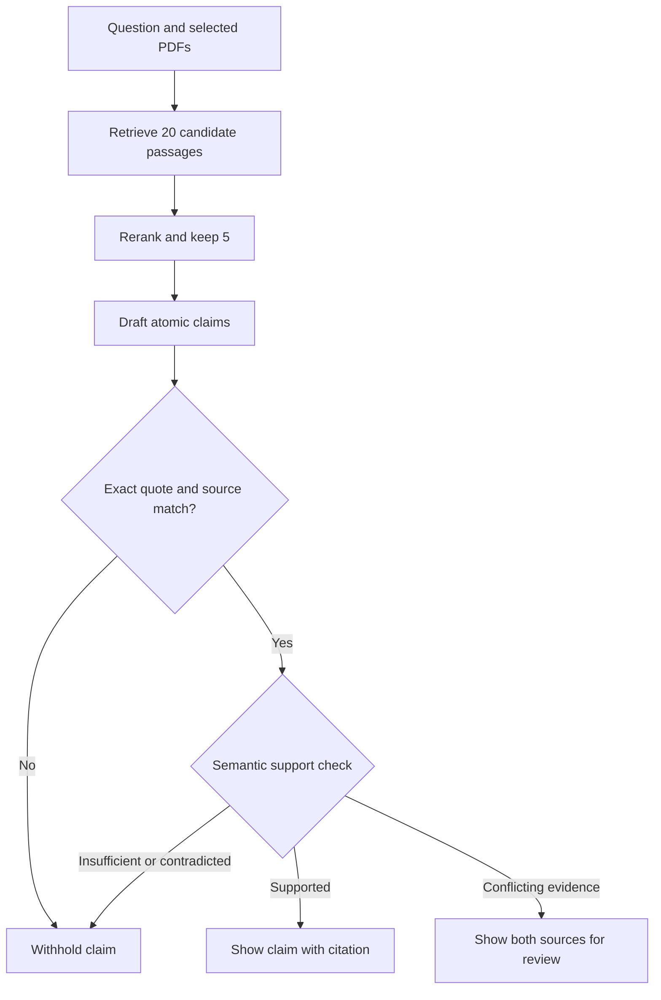

# VeritasAI

### Good answers. Evidence you can see.

VeritasAI is a research workspace that helps you ask questions about PDFs and check whether individual claims are supported by those documents.

A useful answer should let you ask, **“Where did that come from?”** In VeritasAI, each citation opens the exact PDF page and supporting text. If a claim is unsupported, the app withholds it. If retrieved sources appear to disagree, you can inspect both sides.

**Status:** working local implementation with real model inference and PostgreSQL integration tests. Cloud database schema provisioned. A public deployment and GitHub publication are not completed yet; see [deployment status](docs/DEPLOYMENT.md). This is an early research prototype, not a completed publication or a guarantee of truth.

## What you can do

| Feature | How it works |
|---|---|
| Upload multiple PDFs | Text is extracted page by page and stored in your private browser workspace. |
| Search your sources | A real embedding model finds related passages. A separate reranker reorders them. |
| Read source excerpts | Works without any paid API or generative model key. Clearly labelled as excerpts. |
| Check a claim | Enter a statement. Local models check whether your selected documents support or contradict it. |
| Get an AI-written answer | Connect your own Gemini key, or use Ollama on a self-hosted installation. |
| Follow the evidence | Open the original PDF, physical page number, exact quote and highlighted extracted text. |
| Review uncertainty | See supported, contradicted, insufficient and possible-disagreement labels. |
| Compare methods | Run normal RAG, reranked RAG and verified RAG on the same question. |
| Keep a research trail | Reopen saved answers and download a JSON evidence record. |
| Inspect experiments | The evidence lab shows actual fixture measurements, including failures. |

## Start in one command with Docker

Install [Docker Desktop](https://www.docker.com/products/docker-desktop/), open a terminal in this folder, then run:

```bash
docker compose up --build
```

Open **http://localhost:8000**. The first build downloads about 132 MB of model files and installs dependencies. Later builds can reuse the cache.

Docker starts a PostgreSQL database with pgvector, applies the schema, and starts the website. The database uses a named volume, so restarting the containers preserves your documents. The example database password is for this localhost-only installation. Use a separate strong credential for cloud hosting.

To stop the app without deleting documents:

```bash
docker compose down
```

The Docker files are supplied for reproducible deployment. Docker was not available in the implementation environment, so the image build itself is not claimed as tested. The application, dependencies, frontend build and real PostgreSQL-compatible integration flow were tested separately.

## Your first two minutes

1. Click **Upload PDFs**, or **Try our authored sample documents**.
2. Keep the documents you want checked in the left sidebar.
3. Choose **Check a claim**. Try: `The Cedar trial enrolled 120 adults.`
4. Open a citation. The right panel shows its exact page and matching text.
5. Try a claim that the documents do not establish: `The Cedar trial was funded by a pharmaceutical company.`
6. Open **AI settings** if you want a generated explanation rather than source excerpts.

The Cedar and Willow PDFs are fictional test documents. They are not scientific publications or medical evidence.

## Connect Gemini safely

Get your own key from [Google AI Studio](https://aistudio.google.com/apikey). In the app, open **AI settings**, choose **Gemini**, and enter the key in the password field.

- The key is kept in this tab's memory. Refreshing clears it.
- It is sent to the backend for your request and is not stored in the database.
- Relevant document passages and your question are sent to Google. Do not use confidential documents with a provider whose terms do not suit your needs.
- The default is `gemini-3.5-flash-lite`. Model access and free quotas depend on your Google account. You can change the model name.
- For a private installation, the owner can instead set `GEMINI_API_KEY` in the server environment. Do not put it in React code, GitHub or a committed file.

No real Gemini key was available during implementation. Live Gemini generation, quota behaviour and end-to-end generated-answer quality remain unverified. Missing-key and provider-format/error behaviour have explicit tests; no model response is silently faked.

## Run without Docker for development

You need Python 3.12+, Node 24, and PostgreSQL 17+ with the `vector` extension. A dedicated Neon database also works.

```bash
python -m venv .venv
# macOS / Linux:
source .venv/bin/activate
# Windows PowerShell instead:
# .venv\Scripts\Activate.ps1

pip install -r requirements-dev.txt
cp .env.example .env
# On Windows: Copy-Item .env.example .env
```

Set `DATABASE_URL` in `.env` to your database connection string. For Neon, use the pooled URL for the app and the direct URL for `DATABASE_URL_UNPOOLED`.

```bash
python scripts/migrate.py
python scripts/download_models.py
npm ci --prefix frontend
```

In terminal 1:

```bash
uvicorn app.main:app --reload --port 8000
```

In terminal 2:

```bash
npm run dev --prefix frontend
```

Open the URL printed by Vite, usually **http://localhost:5173**. The frontend proxies `/api` requests to FastAPI. For a single-process production-style local run, build with `npm run build --prefix frontend` and open **http://localhost:8000**.

## What is inside

| Part | Technology | Plain-English purpose |
|---|---|---|
| Interface | React, TypeScript, plain CSS, Vite | Document library, question box, evidence viewer and lab |
| API | Python, FastAPI | Checks requests and coordinates the work |
| PDF reading | pypdf | Reads text and keeps physical page numbers |
| Semantic search | Model2Vec POTION, 256 dimensions | Converts text into vectors that can be compared |
| Vector database | PostgreSQL with pgvector | Stores documents, vectors, sessions and answers together |
| Reranking | TinyBERT cross-encoder, ONNX | Looks at the question and passage together |
| Claim checking | DeBERTa NLI, ONNX | Estimates support, contradiction or insufficient evidence |
| Optional answer writing | Gemini API / local Ollama | Writes atomic claims that must pass the checks |
| Charts | Recharts and Matplotlib | Displays measured results and exports figures |
| Deployment | Docker, Vercel configuration, Render blueprint | Portable ways to run the same code |

## How an answer is checked



The generator supplies chunk IDs and quotes. The server resolves the source and page; the model cannot invent a trusted page number. Character offsets refer to **normalized extracted page text**, not pixel coordinates. The PDF viewer still opens the original uploaded file.

Three things remain separate:

1. **Quote integrity:** does this text actually occur on this page?
2. **Source support:** does the cited text support this claim according to a fallible model?
3. **Real-world truth:** is the source itself correct? This application cannot guarantee that.

## Tests and research

Release checks: **20 Python tests and 2 React tests passed**, and the TypeScript/production build passed. See [the validation record](docs/VALIDATION.md) for the test environment and remaining checks.

```bash
python -m pytest tests/test_evidence.py -q
npm test --prefix frontend
python scripts/evaluate.py
```

For full API tests, use a **disposable** PostgreSQL database, apply `scripts/migrate.py`, then set `VERITAS_INTEGRATION_TEST=1` before running `python -m pytest tests -q`. These tests create and delete their own workspaces. Never point the test command at a shared production database.

The included fixture evaluation contains **24 authored examples**. The first measured run produced **macro-F1 0.870**, with **3 false-insufficient predictions**. These results are diagnostic, not proof of lower hallucination rates on real research papers.


See [the experiment protocol](research/PROTOCOL.md) for controlled RAG comparisons, independent annotation and coverage-aware metrics. The app's own verdicts are never treated as human ground truth.

## Read the project in a useful order

1. [User guide](docs/USER_GUIDE.md): every button and status in simple English.
2. [Architecture](docs/ARCHITECTURE.md): how the pieces connect.
3. [File-by-file guide](docs/FILE_GUIDE.md): what each file does.
4. [Design decisions](docs/DECISIONS.md): choices and trade-offs.
5. [Project report](docs/PROJECT_REPORT.md): implemented work, measured results and remaining work.
6. [Research-paper draft](research/PAPER_DRAFT.md): honest preliminary manuscript with prior work.
7. [Deployment](docs/DEPLOYMENT.md): Docker, Vercel and Render setup, plus current blockers.
8. [Privacy and security](docs/SECURITY.md): data boundaries and limits.

## Limits you should know

- Text-based, mostly English PDFs only. No OCR, image understanding or robust table extraction yet.
- Maximum 4 MB and 80 pages per PDF; 20 documents and 30 MB per workspace. The installation also has a 200 MB upload allowance.
- Paragraph detection is heuristic. Complex columns, formulas and layouts can still extract incorrectly.
- Small English models can miss valid support, misunderstand numbers or misread context. The fixture report includes failures.
- A browser cookie is your workspace access key. There is no account recovery or cross-device login yet. Export evidence before clearing browser data.
- Files are kept until explicitly deleted. Deleting a document also removes the workspace's saved answers because they contain source text.
- “Compare methods” needs an actual generative model. Source excerpts are not labelled as a generative RAG baseline.
- Reranker and verifier scores are not calibrated probabilities of correctness.
- No public deployment, browser visual QA, live Gemini run or large independent benchmark is claimed as complete.

## Next research milestone

Build a licensed corpus, freeze development and held-out questions, collect independent human judgments, and test whether verification reduces unsupported claims **without losing too much useful answer coverage**. Publication depends on the evidence and a defensible contribution; it is not guaranteed.
