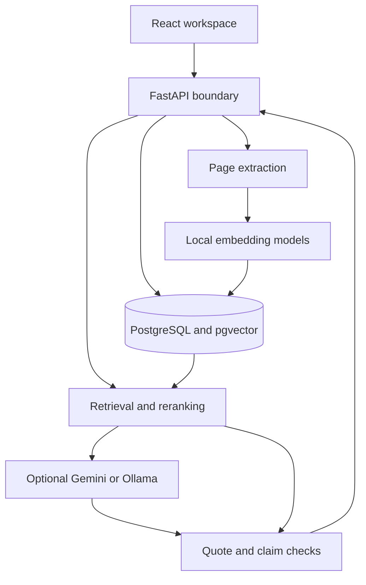

# Architecture

The app has one Python API, one React frontend and one PostgreSQL database. The API serves the compiled frontend in a production-style installation. During development, Vite forwards API calls to FastAPI.

## Data movement

## Ingestion

The upload route limits file size, checks the PDF signature, rejects encrypted files and limits page count. pypdf extracts page text. Unicode is normalized with NFKC, whitespace is normalized, and null characters are removed.

The extractor also retains candidate text blocks using line-length and sentence-ending heuristics. Short headings remain separate from wrapped prose. Blocks are split when they exceed 950 characters, with overlap for long blocks. Very short fragments are not indexed. This is not a full document-layout model; column reading order and table structure remain limitations.

Each chunk contains the document ID, physical PDF page number, start/end offsets in normalized text, exact text, model identity and a 256-dimensional vector. The original bytes, extracted pages and chunks are committed together. A failed transaction does not leave a partially indexed document.

## Retrieval

The query is embedded with the same pinned POTION model. A SQL join restricts chunks to the current workspace and selected document IDs before cosine ranking. The database returns at most 20 candidates.

The baseline takes the first five. The reranked variants use a TinyBERT cross-encoder over the same 20 candidates, then keep five. Exact vector search is deliberate at this scale; there is no approximate index that might reduce per-workspace recall.

## Generation

The optional generator receives the question plus five evidence passages. It returns JSON containing atomic claims with chunk IDs and exact quotes. The prompt preserves qualifications and tells the model to ignore instructions in source material. A Pydantic schema rejects malformed, excessively long or unexpected output.

The prompt is only one safeguard. The model has no tools, shell access, arbitrary URL access or database access. It cannot turn document instructions into external actions. Its citations are checked against the already-authorized retrieved passages.

## Verification

1. Look up each citation's chunk ID in the current retrieval context.
2. Normalize the proposed quote and require an exact contiguous match of at least 12 characters.
3. Derive source name, hash, page and offsets on the server.
4. Use local DeBERTa NLI to compare each valid quote with the claim.
5. Compare the claim with all five context passages for possible contradictions.
6. Retain a supported claim, flag possible disagreement, or withhold it.

Support requires at least one individually supportive citation. The prototype does not implement joint multi-hop entailment across several insufficient passages. Other citations can have intact quotes without supporting the claim; each gets its own `relation` field. This distinction is essential when evaluating citation correctness.

Support and contradiction thresholds are fixed operational values (0.80 and 0.85). They have not been calibrated on an independent research dataset. Softmax scores must not be shown as truth probabilities.

## Persistence and isolation

| Table | Stores |
|---|---|
| `workspaces` | Random ID and a hash of the browser access token |
| `documents` | Owner workspace, filename, hash, original PDF bytes and size |
| `pages` | Physical page index, printed label and normalized text |
| `chunks` | Text spans and embedding vectors |
| `runs` | Saved question, answer, claims, evidence and audit JSON |
| `rate_limits` | Shared counters, so limits survive serverless instances |
| `schema_migrations` | Applied schema versions |

Workspace isolation is enforced in parameterized API queries and tested with two independent cookie jars. It is not PostgreSQL row-level security. The browser never receives a database credential. The database owner credential should be replaced with a restricted application role before a broad public deployment.

Document deletion and answer saving both lock the workspace row. Saving checks that every referenced document still exists. This prevents a concurrent answer from recreating deleted source excerpts in history.

## Failure behaviour

Invalid PDFs get a readable 422 response. Unknown documents and other-workspace documents both return 404. Provider timeouts, quota problems and invalid responses produce explicit errors; there is no silent replacement with a fake answer. Transient provider failures retry at most once. Failed generation is not saved as a successful run.

There is no durable background job queue. Upload processing and answer generation occur within bounded HTTP requests. Moving long documents or large research jobs to workers is future work.

