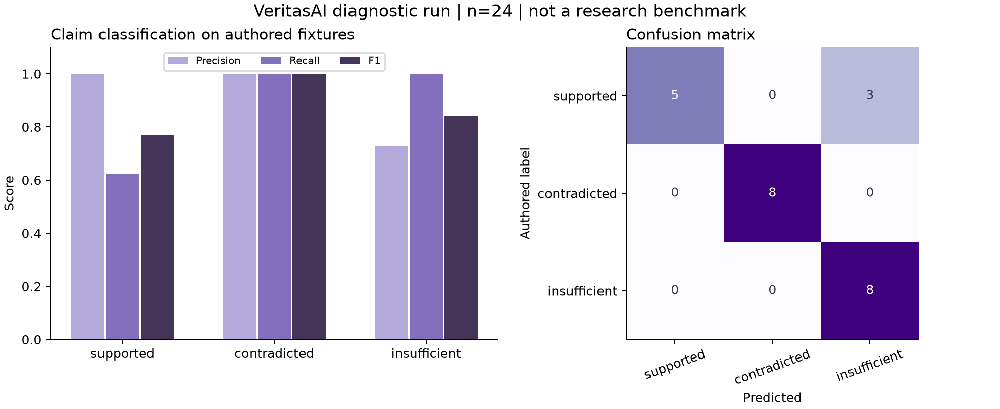

# VeritasAI: Inspectable Claim-Level Evidence Checks for Document Question Answering

**Sankalp Gupta**  
**Preliminary manuscript — 14 October 2026**

This is a draft describing an implemented prototype and small diagnostic evaluation. It is not a published paper, a completed research study, or evidence of a novel state-of-the-art method. Sections requiring new experiments are explicitly marked pending.

## Abstract

Document question-answering systems can produce fluent statements whose citations are missing, incorrect or insufficient. We describe VeritasAI, a prototype that connects atomic answer claims to exact passages and physical pages of uploaded PDFs. A deterministic provenance check is followed by a local natural-language-inference classifier. Unsupported claims are withheld, while possible counterevidence is shown for review. The implementation supports dense retrieval, cross-encoder reranking, and verification of a fixed reranked draft, enabling a controlled study of verification's effect on unsupported claims and answer coverage. On 24 authored development pairs, the verifier achieved macro-F1 0.870, with three supported claims classified as insufficient. This diagnostic result demonstrates functioning inference and exposes missed support; it does not establish hallucination reduction on real research documents. Independent application-level evaluation remains future work.

## 1. Introduction

Retrieval can make relevant text available to a language model without guaranteeing that its answer follows from that text. A citation can point to a real page and still fail to support the associated statement. Conversely, an overly conservative verifier can remove useful information.

VeritasAI separates three questions: whether a quote exists, whether it supports a claim, and whether the underlying source is true. The first is checked against stored document text. The second is estimated by a fallible classifier. The third cannot be resolved merely by matching a document and is outside the system's guarantees.

The current artifact contributes a reproducible implementation with source-page provenance, visible rejected claims, and a controlled comparison protocol. We do not claim that claim decomposition, retrieval or NLI verification is new. A publishable contribution would require a new evaluated method or a meaningful, well-supported empirical result.

## 2. Related work

**ALCE** evaluates language-model answers with citations and distinguishes answer correctness from citation quality [1]. VeritasAI adopts that separation. Its initial citation-set metric is narrower than ALCE's individual-citation precision and is not presented as equivalent.

**FActScore** studies support for atomic facts in generated text [2]. VeritasAI similarly makes claims the unit of checking, but the current generator supplies those units rather than using a separately validated decomposition system.

**RARR** researches attribution and revision of generated text [3]. VeritasAI's initial implementation withholds unsupported claims instead of automatically rewriting them. This makes changes easy to audit but may reduce coverage.

**Self-RAG** integrates retrieval and self-reflection into language-model behavior [4]. VeritasAI uses separate retrieval, generation and NLI components and does not reproduce Self-RAG training or evaluation.

**SciFact** provides scientific claim-verification data and evidence annotations [5]. It is a suitable future external verifier benchmark, but abstract evidence does not test the original PDF page provenance required by this application.

## 3. Method

### 3.1 Document provenance

For each uploaded PDF, the system stores the original bytes and SHA-256 hash. Text is extracted separately for each physical page, normalized using Unicode normalization and whitespace rules, and split into bounded paragraph-oriented passages. Each passage retains a document ID, physical page number and character interval in normalized page text. Printed page labels are additional metadata and may differ from physical page numbers.

The current paragraph heuristic cannot reliably handle every table, column or formula. Page provenance is preserved even when extraction quality is imperfect; users can inspect the original page alongside the extracted text.

### 3.2 Retrieval and generation

A pinned POTION embedding model produces 256-dimensional vectors. PostgreSQL with pgvector retrieves the top 20 passages by cosine similarity, restricted to the user's selected documents. A quantized TinyBERT cross-encoder optionally reranks those candidates. The first five passages form the generator context.

An optional Gemini or self-hosted Ollama generator returns structured claims with cited passage IDs and quotations. Output validation limits claim count and length. The model cannot supply authoritative page metadata; the server resolves it from the retrieved passage. A separate extractive mode and user-supplied claim checking work without generation and are not counted as generative RAG baselines.

### 3.3 Quote integrity and semantic checks

Let a claim be \(c\), its cited quotations be \(Q(c)\), and the retrieved context be \(P\). A citation passes integrity only if its passage belongs to the selected context and its normalized quote occurs exactly in that passage. Missing, unknown or mismatched citations cause the verified claim to be withheld.

For valid citations, the NLI model estimates entailment for each pair \((q,c)\). A claim has support if at least one quotation reaches the support threshold \(\tau_s=0.80\). The model separately scores contradiction for pairs \((p,c)\) over retrieved passages, with threshold \(\tau_c=0.85\).

| Support threshold reached | Counterevidence threshold reached | Display decision |
|---|---|---|
| Yes | No | Retain as supported, with inspectable evidence |
| Yes | Yes | Retain with a possible-disagreement warning and both evidence sides |
| No | Yes | Withhold as contradicted |
| No | No | Withhold as insufficient |

These scores are not calibrated truth probabilities. Contradiction also requires compatible scope in a real research analysis: different dates, populations or outcomes may explain apparently opposing text. The interface therefore calls these findings possible disagreements and asks the reader to inspect context.

This initial method uses maximum single-quote support. It does not establish support that emerges only from combining several passages, nor does it prove that every cited passage is necessary.

### 3.4 Controlled comparison

We define three variants. Dense RAG uses the first five dense-search results. Reranked RAG uses the reranker's first five. Verified RAG checks the exact cached draft from reranked RAG using the same context. Both baseline variants record citation integrity but do not filter by semantic support.

Sharing the draft isolates verification from variation in generation. No new evidence is retrieved only for the verified variant. If future verification uses extra retrieval, the protocol must add a matched extra-context baseline. Cached comparison timings cannot be interpreted as independent full-pipeline latency measurements.

## 4. Evaluation design

The initial diagnostic evaluation uses 24 authored evidence–claim pairs, with eight examples per class. Labels were authored before inference. The same quantized NLI model and thresholds used by the application classify these pairs. This is a development test, not a representative held-out benchmark.

Application-level evaluation is **pending**. The planned study uses licensed documents, frozen document-family splits, predefined required answer facts, and independent claim and citation judgments. It includes answerable, unanswerable, numerical and multi-document questions. Two annotators should review blinded outputs and adjudicate disagreements.

Primary outcomes are unsupported retained-claim rate and answer-fact coverage. Secondary outcomes include citation-set support, correct and false abstention, retained claim count, and controlled latency. Undefined rates remain undefined rather than being converted to perfect scores. Paired bootstrap resampling by question estimates uncertainty in verified-minus-reranked unsupported rate; small convenience samples still limit generalization.

The collection and scoring scripts implement the data flow and reject missing review labels. Their controlled unit tests are not evidence about model quality. Detailed definitions and commands appear in [PROTOCOL.md](PROTOCOL.md).

## 5. Preliminary results

| Gold class | Predicted supported | Predicted contradicted | Predicted insufficient |
|---|---:|---:|---:|
| Supported | 5 | 0 | 3 |
| Contradicted | 0 | 8 | 0 |
| Insufficient | 0 | 0 | 8 |

The resulting macro-F1 was 0.870445. Supported-class recall was 0.625, illustrating missed valid evidence. The three failures concerned paraphrased eligibility, study location and sleep duration. A classifier that produces no false-supported predictions on this small set may still produce false support on unseen documents.

The evaluation took approximately 1.05 seconds including loading on the implementation CPU environment. This is not a cloud benchmark. The raw output contains timestamps, labels, scores, model identifier, thresholds and failures. Pinned model revisions and SHA-256 file hashes are stored alongside it.

**End-to-end results pending:** No independently annotated dense-versus-reranked-versus-verified RAG comparison has been run. No hallucination-reduction percentage, citation-quality improvement or statistical significance claim is reported.

## 6. Limitations and threats to validity

The authored diagnostic sample is small and susceptible to author bias. Thresholds have not been calibrated on a representative scientific corpus. The verifier is an English general-purpose NLI model, not a scientific truth oracle. Negation, numerical reasoning, discourse context and truncation can cause errors.

Claim atomicity is requested from the generator but is not independently guaranteed. Maximum single-quote support misses joint reasoning and can be vulnerable to incomplete context. Counterevidence search is limited to retrieved passages; absence of a warning does not establish consensus. Source documents may themselves contain errors or malicious instructions.

PDF extraction does not include OCR or reliable structured table understanding. Workspace cookie access lacks user-account recovery. Native hosted-database behavior, Docker capacity, browser accessibility and live provider integration require further deployment validation. Independent reviewers, licensed corpus splits and broader replication are needed before making general research claims.

## 7. Reproducibility and data handling

The source includes installation instructions, model-download revisions, SQL migration, fictional PDF fixtures, raw diagnostic results, experiment scripts and a test suite. Models are downloaded from their pinned upstream repositories and are not bundled in the source archive. Model identifiers and licenses are documented in [THIRD_PARTY.md](../docs/THIRD_PARTY.md).

Users must have permission to process uploaded documents. Optional external generation transmits the selected question and passages to the chosen provider. No real customer or company records were used in the included fixtures. AI coding assistance was used in implementation and drafting; the project owner remains responsible for understanding and validating the work.

## 8. Conclusion and next study

VeritasAI implements an inspectable connection between answer claims and document evidence. The preliminary diagnostic exposes missed support and motivates measuring the trade-off between unsupported claims and useful answer coverage. A frozen, independently annotated application evaluation is the next step; publication and broader reliability claims depend on those results.

## References

1. Gao, T., Yen, H., Yu, J., and Chen, D. (2023). *Enabling Large Language Models to Generate Text with Citations.* EMNLP. https://aclanthology.org/2023.emnlp-main.398/
2. Min, S., et al. (2023). *FActScore: Fine-grained Atomic Evaluation of Factual Precision in Long Form Text Generation.* EMNLP. https://aclanthology.org/2023.emnlp-main.741/
3. Gao, L., et al. (2023). *RARR: Researching and Revising What Language Models Say, Using Language Models.* ACL. https://aclanthology.org/2023.acl-long.910/
4. Asai, A., et al. (2024). *Self-RAG: Learning to Retrieve, Generate, and Critique through Self-Reflection.* ICLR. Author repository: https://github.com/AkariAsai/self-rag
5. Wadden, D., et al. (2020). *Fact or Fiction: Verifying Scientific Claims.* EMNLP. https://aclanthology.org/2020.emnlp-main.609/
